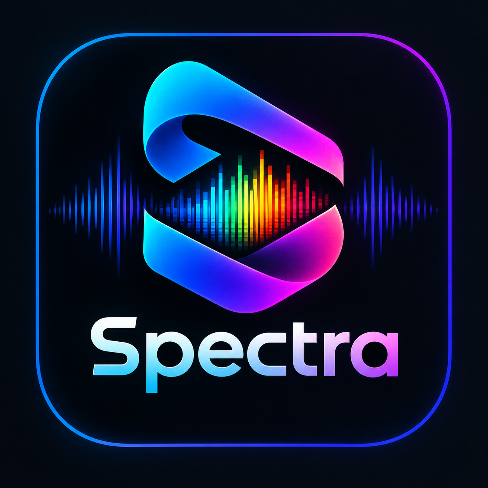

<div align="center">

<br/>



# Spectra

### Audio Forensics Analyzer for Android

<p>
  <strong>Is that "lossless" file really lossless? Find out.</strong><br/>
  <em>Spectrogram + fake-lossless detection + LUFS, true peak and dynamic range, all on your phone.</em>
</p>

<br/>

[](https://github.com/aravindrejidev/Spectra/releases)
[](https://github.com/aravindrejidev/Spectra/stargazers)
[](https://github.com/aravindrejidev/Spectra/releases)
[](https://github.com/aravindrejidev/Spectra/blob/main/LICENSE)


<br/>

[**Showcase**](#showcase) · [**Features**](#features) · [**Verdict**](#verdict) · [**Download**](#download) · [**Architecture**](#architecture) · [**Contributing**](#contributing) · [**Support**](#support) · [**Disclaimer**](#disclaimer)

<br/>

</div>

> [!NOTE]
> Spectra shows you the evidence behind every verdict. It can show that a file *looks* lossy or upsampled, but it can't prove that a file is genuine. See [Disclaimer](#disclaimer).

---

<a id="about"></a>
## 🌟 About the Project

**Spectra** is a native Android app that looks inside your audio files and tells you what they really are. It decodes a track bit-exactly with FFmpeg, measures it in a single pass, and shows the result on a rack-mounted hardware unit with metal panels, glowing LEDs and a phosphor display.

Is that FLAC a real lossless rip, or a 128 kbps MP3 in disguise? Is the "24-bit" file really 24-bit? How loud is the master, and is it clipping? Spectra answers all of it, and shows its work.

No accounts. No ads. No telemetry. Your audio never leaves the phone; the network is used only to check GitHub for new versions.

---

<a id="showcase"></a>
## 📸 Showcase

<div align="center">
  
  <br/><br/>
  <table>
    <tr>
      <td width="33%" align="center">
        <br />
        <sub><b>Home</b></sub>
      </td>
      <td width="33%" align="center">
        <br />
        <sub><b>Verdict & Evidence</b></sub>
      </td>
      <td width="33%" align="center">
        <br />
        <sub><b>Spectrogram</b></sub>
      </td>
    </tr>
    <tr>
      <td width="33%" align="center">
        <br />
        <sub><b>Levels & Loudness Timeline</b></sub>
      </td>
      <td width="33%" align="center">
        <br />
        <sub><b>Batch Scan</b></sub>
      </td>
      <td width="33%" align="center">
        <br />
        <sub><b>Settings</b></sub>
      </td>
    </tr>
  </table>
</div>

---

<a id="features"></a>
## ✨ Features

<div align="center">

<table>
  <tr>
    <td width="50%" valign="top">

#### Authenticity Detection
- **Fake-lossless & upsample detection** — finds the low-pass "cutoff edge" that lossy encoders leave behind and checks how persistently it shows up across the whole track.
- **Evidence, not just a verdict** — every GOOD / WARN / BAD result lists the reasons behind it.
- **Inflated-bitrate check** — flags files that claim a high bitrate but have the spectrum of a much lower one.
- **Encoder-tag clues** — reads container and encoder tags for signs of a lossy origin.
- **Effective bit depth** — compares the declared depth with what is actually in the samples, e.g. `24 (eff. 24)`.

#### Measurements
- **Loudness** — ITU-R BS.1770 K-weighted LUFS and LRA, with proper 5.1 / 7.1 channel weighting.
- **Loudness timeline** — see how loudness moves through the track.
- **True peak** — 4× oversampled, every sample checked.
- **Dynamic range** — DR-meter style value.
- **Clipping timeline** — clipped samples per second along the track.
- **DC offset and stereo field** — spot offset, mono, inverted or wide mixes.

    </td>
    <td width="50%" valign="top">

#### Spectrogram
- **Full-track spectrogram** from a streaming STFT, so long files stay light on memory.
- **LIN / LOG** frequency scale and an adjustable dB floor.
- **L / R / MID / SIDE** views from a single paired FFT.
- **Touch probe** — tap anywhere for the exact frequency and level.
- **Average spectrum plot** next to the spectrogram.

#### Files & Batch
- **FFmpeg decoding** — bit-exact, including 24-bit ALAC, with Android's own decoder as fallback.
- **File details** — container, codec, profile, bitrate, channel layout, sample format and tags.
- **Batch scan** — analyze whole folders (sub-folders included) and export **CSV** or **PDF**.
- **Share a report** — as text, image or PDF.
- **Open from anywhere** — send an audio file from another app straight into Spectra.

#### Experience
- **Skeuomorphic rack-unit UI** — metal panels, LED ladders, glowing glass displays and smooth motion.
- **Trophies, a "Spot the fake" mini-game** and rotating audio tips.
- **Built-in self-test** that checks the measurements against known reference signals.
- **Progress & finished notifications**, so a long scan survives a trip to another app.
- **In-app updater** with a daily background check, powered by GitHub Releases.
- **Settings** for motion, decoder, true peak, clipping sensitivity, notifications and more.

    </td>
  </tr>
</table>

</div>

---

<a id="verdict"></a>
## 🔬 How the Verdict Works

Lossy encoders (MP3, AAC, Opus and friends) throw away the highest frequencies. That leaves a sharp low-pass edge in the spectrum that survives even when a file is later converted to FLAC. Spectra looks for that edge and weighs it against everything else it knows about the file.

| What Spectra sees | What it usually means |
|---|---|
| No cutoff edge | Looks good |
| Edge at 21 kHz or above | Normal anti-aliasing, looks good |
| Edge between 19.5 and 21 kHz | Ambiguous: CD-era filtering or a high-bitrate lossy encode |
| Edge below 19.5 kHz | Typical lossy fingerprint, flagged |
| Hi-res file with an edge near 21–24 kHz | Likely upsampled from a lower sample rate |
| High declared bitrate, but the edge sits low | Inflated bitrate, flagged |

These are guidelines, not hard rules. The final verdict combines the edge, how persistent it is over time, the declared bitrate and bit depth, and the encoder tags.

---

<a id="download"></a>
## 📥 Download & Installation

<div align="center">

<a href="https://github.com/aravindrejidev/Spectra/releases/latest" target="_blank" rel="noopener noreferrer"></a>
<a href="https://apps.obtainium.imranr.dev/redirect?r=obtainium://add/https://github.com/aravindrejidev/Spectra" target="_blank" rel="noopener noreferrer"></a>

Grab the latest signed APK from the [Releases](https://github.com/aravindrejidev/Spectra/releases) page. Sideloading requires enabling "Install unknown apps" for whichever app you download it with.

Once installed, Spectra tells you when a new version is out and can download and install it for you.

</div>

### Getting Started
1. Open Spectra and tap **LOAD TRACK**, or share an audio file to Spectra from another app.
2. Wait for the scan to finish. The progress shows in the app and in a notification.
3. Read the **verdict** first, then dig into the spectrogram, levels, timeline and file details.
4. Share the report, or scan a whole folder from the **Batch** panel.

### Building from Source
```bash
git clone https://github.com/aravindrejidev/Spectra.git
cd Spectra
./gradlew assembleDebug
# Built APK will be located at: app/build/outputs/apk/debug/
```
*Prerequisites:* Android Studio and Android SDK 35. FFmpeg comes in as a regular Maven Central dependency, so there is no native build step.

---

<a id="architecture"></a>
## 🏗️ Architecture & Tech Stack

Spectra is a single-module Kotlin app built with Jetpack Compose. The analysis engine is plain Kotlin DSP code with no external analysis libraries.

| Package | What it does |
|---|---|
| `ui/` | Compose screens, rack-unit components, spectrogram views, ViewModels |
| `decode/` | FFmpeg decoder (primary) and MediaCodec fallback, file facts via ffprobe |
| `dsp/` | Streaming spectrogram, cutoff-edge detection, loudness, true peak, verdict engine, self-test |
| `metadata/` | Tags and basic file metadata |
| `notify/` | Progress notifications, finished alerts, foreground service |
| `update/` | GitHub release checker, installer, daily background worker |
| `engage/` | Trophies, stats, mini-game support |
| `settings/` | User preferences |
| `model/` | UI state |

**Built with:** Kotlin · Jetpack Compose · FFmpeg (LGPL build via `ffmpegkit-maintained`) · Android MediaCodec · WorkManager · GitHub Actions

---

<a id="support"></a>
## ☕ Support the Project

Spectra is free and open source, with no ads or subscriptions. If it helped you spot a fake, you can support it by:

- ⭐ **Starring** the repository
- 📣 **Sharing** it with fellow audio nerds
- 🐛 **Reporting** bugs and odd results on the [issues page](https://github.com/aravindrejidev/Spectra/issues)

<!-- Add your donation links here, for example Ko-fi or PayPal -->

### 📈 Star History

<p align="center">
  <a href="https://star-history.com/#aravindrejidev/Spectra&Date">
    
  </a>
</p>

---

<a id="contributing"></a>
## 💡 Contributing

Contributions are welcome, whether it's a bug fix, a new check, or better wording.

- Found a file Spectra gets wrong? Open an [issue](https://github.com/aravindrejidev/Spectra/issues) and describe the file (format, source, what you expected). Real-world examples help the verdict engine most.
- For bigger changes, open an issue first so we can talk it through.
- Pull requests should build cleanly and keep the on-device **self-test** passing.

### 👥 Contributors

<div align="center">
  <a href="https://github.com/aravindrejidev/Spectra/graphs/contributors">
    
  </a>
</div>

---

<a id="acknowledgments"></a>
## 🤝 Acknowledgments

- **[FFmpeg](https://ffmpeg.org/)** and the **[ffmpegkit-maintained](https://github.com/ffmpegkit-maintained)** project — for decoding and file probing.
- **ITU-R BS.1770 / EBU R128** — the loudness measurement standards behind LUFS, LRA and true peak.
- **Jetpack Compose** and **AndroidX WorkManager** — the foundations of the UI and background work.

---

<a id="disclaimer"></a>
## ⚖️ License & Disclaimer

### License
See the [LICENSE](LICENSE) file for details. Spectra uses FFmpeg, which is distributed under the LGPL.

### Disclaimer
- **Evidence, not proof.** A clean result means Spectra found no signs of a lossy origin. It does not prove a file is genuine, and a flagged result means the file *looks* lossy or upsampled.
- **Measurements are close, not certified.** Dynamic range can differ by about ±1 from the official DR meter, and true peak can read slightly low on heavily clipped masters.
- **Still learning.** The verdict thresholds are being tuned against more real-world files. If a verdict looks wrong, please report it.
- **Privacy.** All analysis runs on the device. Spectra does not upload your audio.

---

<div align="center">
  Built with care and a lot of test tones. Happy listening! 🎧
</div>
